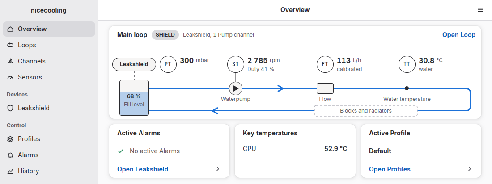
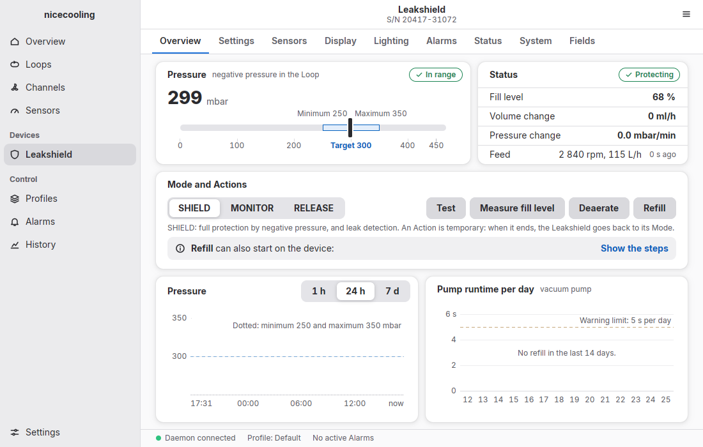
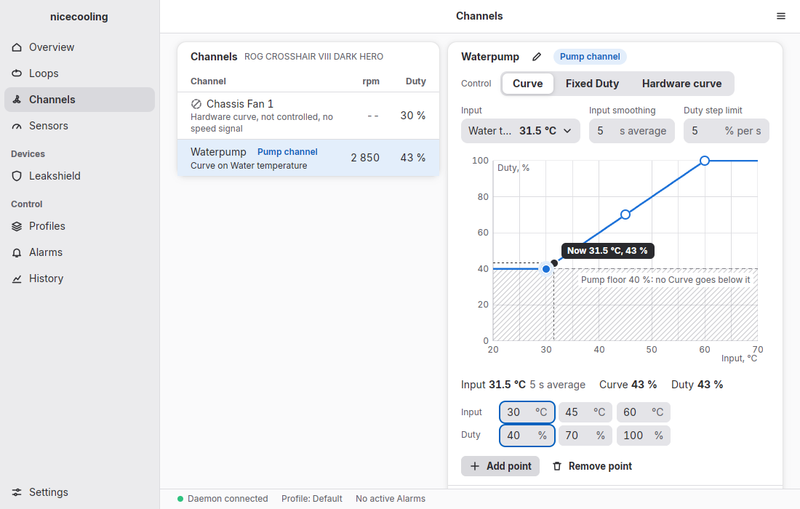
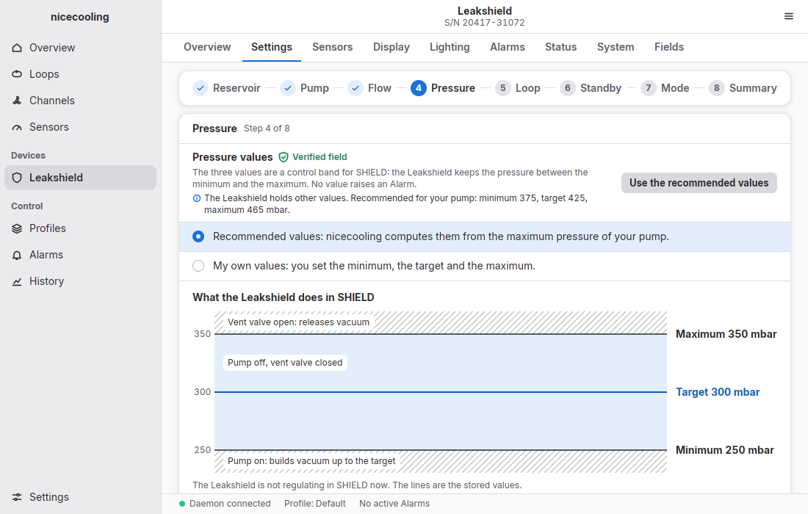

<h1 align="center">
  <picture>
    <source media="(prefers-color-scheme: dark)" srcset="docs/images/logo-dark.svg">
    
  </picture>
</h1>

<p align="center">
  <a href="LICENSE"></a>
  
  
</p>

nicecooling is an open-source replacement for aquasuite on Linux. It controls the water loop of a desktop PC and it configures and monitors the Aqua Computer LEAKSHIELD.

The system service `nicecoolingd` does the control. The app `nicecooling` shows a window, a tray icon and desktop notifications.

nicecooling is not a product of Aqua Computer and has no connection with that company. aquasuite and LEAKSHIELD are names of Aqua Computer.

<p align="center">
  <a href="#what-it-does-today">What it does today</a> |
  <a href="#screenshots">Screenshots</a> |
  <a href="#supported-hardware">Supported hardware</a> |
  <a href="#install">Install</a> |
  <a href="#rollback">Rollback</a> |
  <a href="#documentation">Documentation</a> |
  <a href="#license">License</a>
</p>

<p align="center">
  
</p>

## What it does today

Loop control:

- Fan and pump Channels of the mainboard through hwmon: a Curve on any sensor, a fixed Duty, or the Hardware curve of the BIOS.
- A Loop with its pump, its flow sensor with a calibration table, its water temperature and its Leakshield.
- A minimum pump Duty, and full speed for every Channel when a sensor is lost or the pump stops.
- Profiles that switch by hand or by rules: a sensor value, a running process, a time window.
- Alarms and Warnings with a desktop notification, and a poweroff after a countdown that the user can cancel.
- A history of every sensor: 1 s samples for 48 hours, 1 minute values for one year.

Leakshield:

- Mode (SHIELD, MONITOR, RELEASE) and the Actions: test, fill level measurement, deaeration, refill.
- A settings wizard for the reservoir, the pump, the flow, the pressure band, the loop height, standby and Mode.
- The live values: pressure, fill level, volume and pressure change, pump runtime per day, events.
- The device display: the image of each page, templates, data sources, texts, icons and the logo.
- Lighting, alarm limits and Device responses, sensor names and Software sensors.
- A backup before each write, a restore, and the four profile slots of the device.

Planned: sensors and responses built from a graph of nodes, MQTT, the firmware update of the Leakshield, more devices.

## Screenshots

The images show the app with test data.

| Leakshield | Curve of a Channel | Pressure step of the settings wizard |
|---|---|---|
| [](docs/images/leakshield.png) | [](docs/images/curve-editor.png) | [](docs/images/pressure-settings.png) |

## Supported hardware

| Part | Supported |
|---|---|
| Operating system | Fedora on x86_64 with GNOME. The app is in English, Italian, German and French. |
| Mainboard | A Board needs a Board file in `data/boards/`. One exists: ASUS ROG CROSSHAIR VIII DARK HERO. |
| Leakshield | Firmware 1022. The daemon reads a Leakshield with another firmware and does not write it. |
| Flow sensor | A sensor on a fan header, with a calibration table in `data/calibration/`. One exists: Alphacool 17558. |

nicecooling is version 0.1.0 and is tested on one desktop. It writes the settings of a leak protection device: read the Rollback section before the first start.

## Install

Before the first start, update the Leakshield to firmware 1022 with aquasuite (`docs/protocol/leakshield.md`).

1. Build the RPM in a container: `packaging/container/build-rpm.sh`. It needs `podman` and network. The RPM is `target/rpm/RPMS/x86_64/nicecooling-<version>.rpm`.
2. Install it: `sudo dnf install ./target/rpm/RPMS/x86_64/nicecooling-*.rpm`. The package sets the daemon to start at boot.
3. Start the daemon: `sudo systemctl enable --now nicecoolingd`.
4. Check it: `systemctl is-active nicecoolingd` prints `active`.
5. Start the app: `nicecooling`. `docs/app.md` explains the first run and the tray icon.

The first start of the daemon takes the BIOS snapshot: the `pwm` attributes of each Channel as the BIOS left them. The snapshot is `/var/lib/nicecooling/bios-snapshot.json`. The daemon saves it before the first Channel write.

The package installs the daemon, the app, the systemd unit and its preset, the `poweroff.target` drop-in, the D-Bus policy, the polkit action and rule, the desktop entries, the icons and the Board files. The RPM owns each of them.

## Hardware watchdog (optional)

When the kernel hangs, the Channels stay at the last duty. A hardware watchdog resets the machine in that case. systemd feeds the watchdog when `RuntimeWatchdogSec` is set in the `[Manager]` section of `/etc/systemd/system.conf`. Fedora does not ship that file. Create it, or use a drop-in, which systemd recommends:

```sh
sudo mkdir -p /etc/systemd/system.conf.d
printf '[Manager]\nRuntimeWatchdogSec=30s\n' | sudo tee /etc/systemd/system.conf.d/50-watchdog.conf
sudo systemctl daemon-reload
systemctl show -p RuntimeWatchdogUSec
```

The last command prints `RuntimeWatchdogUSec=30s`. The setting belongs to the host: the package does not set it. The mainboard must have a watchdog device (`/dev/watchdog0`).

## Rollback

The Migration Plan in [`openspec/changes/add-nicecooling-v1/design.md`](openspec/changes/add-nicecooling-v1/design.md) (section "Migration Plan") defines the steps. In short:

1. Stop the service: `sudo systemctl stop nicecoolingd`. This restores the BIOS snapshot: each Channel goes back to its snapshot attributes.
2. If wanted, restore the first Leakshield backup of the device with `RestoreBackup` (`docs/api.md`, section "Leakshield backups"). The backups are in `/var/lib/nicecooling/backups/`.
3. Remove the package: `sudo dnf remove nicecooling`. The RPM owns each file it installs, so the removal deletes them.

Files that remain after the removal:

- `/var/lib/nicecooling/`: the daemon state, the BIOS snapshot and the Leakshield backups. Delete it by hand to remove it.
- `~/.local/share/nicecooling/` of each user: the app history.
- `~/.config/nicecooling/` and `~/.config/autostart/io.github.cappyt.NiceCooling.desktop` of each user: the app settings and the "Start at login" override.

## Documentation

| Document | Content |
|---|---|
| [`GLOSSARY.md`](GLOSSARY.md) | The terms of the project. |
| [`docs/app.md`](docs/app.md) | The app: first run, tray icon, files. |
| [`docs/api.md`](docs/api.md) | The D-Bus API of the daemon. |
| [`docs/storage.md`](docs/storage.md) | The files of the daemon and of the app. |
| [`docs/protocol/leakshield.md`](docs/protocol/leakshield.md) | The Leakshield protocol. |
| [`docs/adr/`](docs/adr/) | The decisions of the project and their reasons. |
| [`openspec/`](openspec/) | The specs and the tasks of each change. |

## License

GPL-3.0-or-later. See [`LICENSE`](LICENSE).
